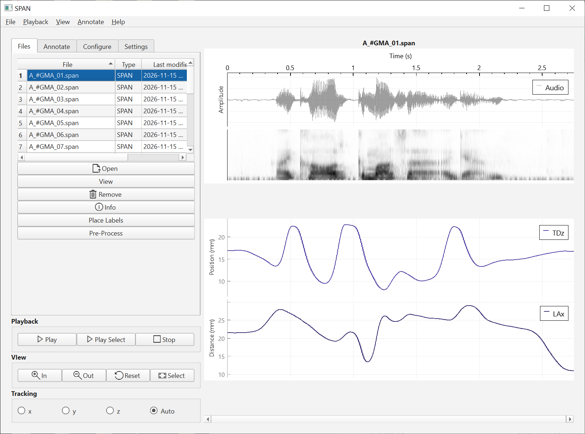
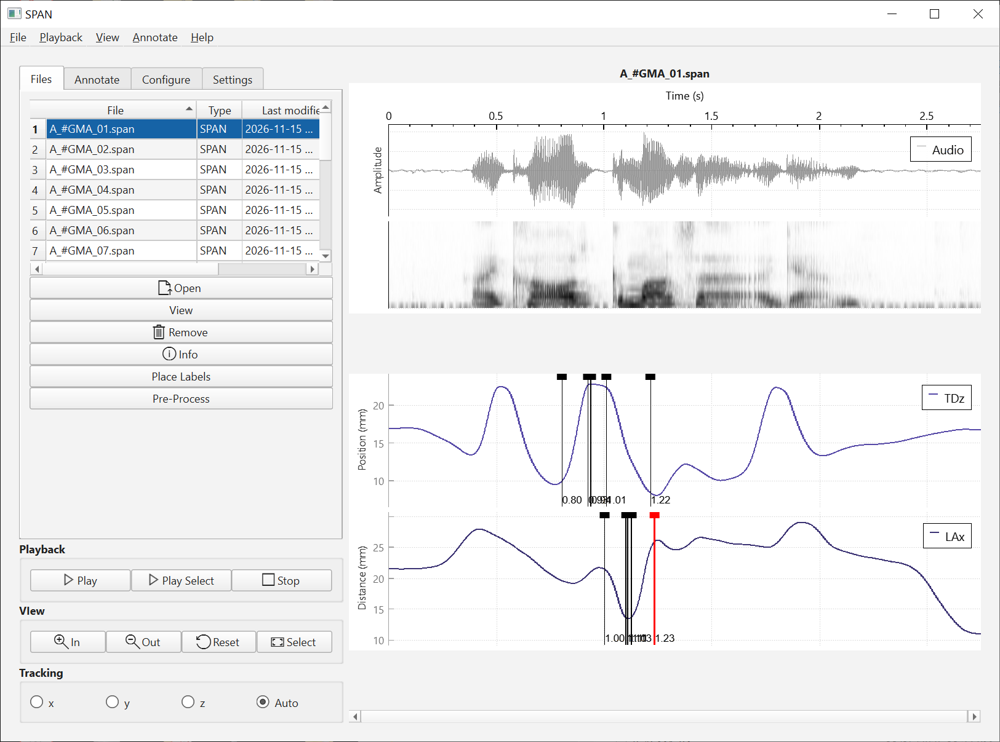
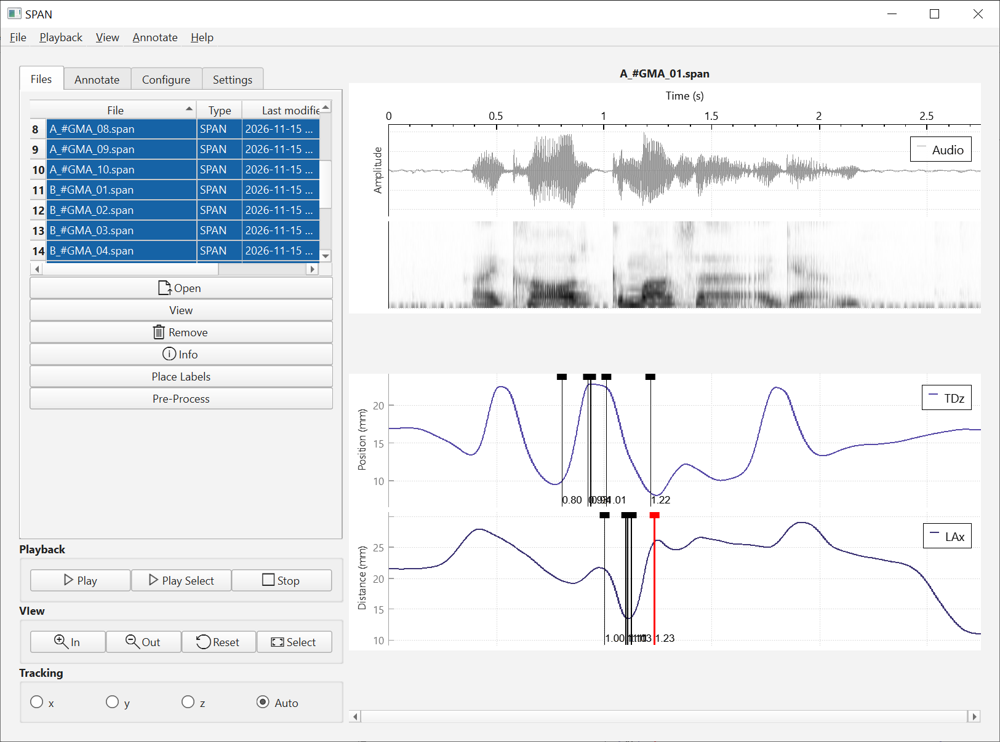
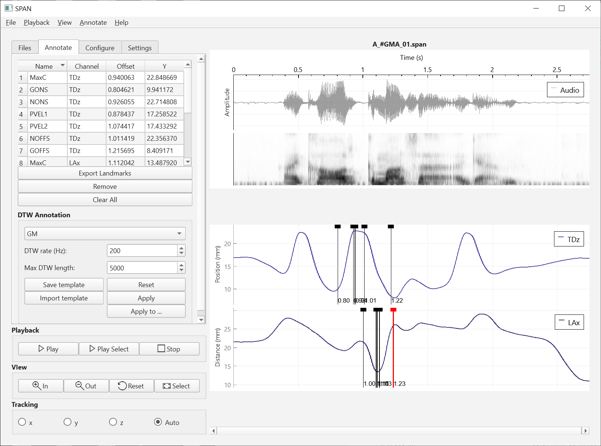
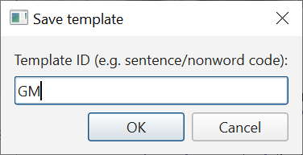
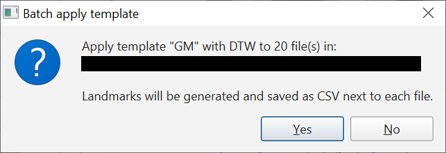
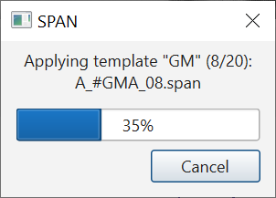
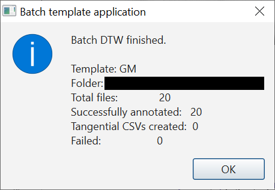
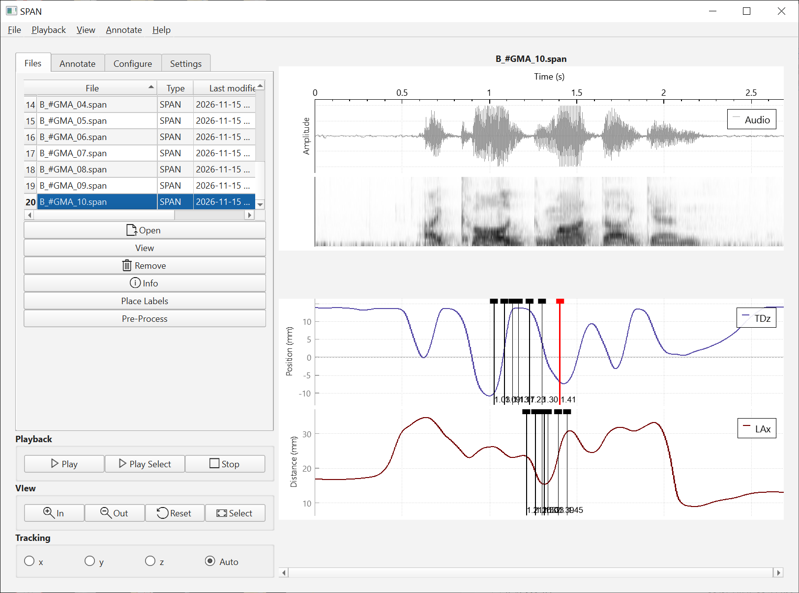

# DTW-Assisted Multi-Gesture and Multi-Channel Annotation in SPAN

*A step-by-step tutorial for SPAN v0.3.0*

## Overview

This tutorial demonstrates how to use SPAN to annotate multiple articulatory gestures across multiple channels with **one dynamic time warping (DTW) template**. It focuses on the integrated workflow: selecting representative gestures, deriving their kinematic landmarks, saving a multi-gesture template, applying that template to multiple recordings, inspecting the resulting annotations, and exporting landmark data.

The example dataset comprises **20 electromagnetic articulography (EMA) recordings** of comparable productions by two speakers: **10 from Speaker A (female)** and **10 from Speaker B (male)**. The demonstration uses two channels:

- **TDz:** vertical position of the tongue dorsum sensor.
- **LAx:** the lip-aperture distance channel, derived in these files from the upper- and lower-lip sensors. The channel name is retained as displayed by SPAN; it should not be interpreted as the horizontal component of lip separation.

One recording from Speaker A, `A_#GMA_01.span`, provides representative gestures from **both** channels. These gestures are saved together in a template identified as `GM`. The same template is then applied to all 20 recordings, illustrating within-speaker reuse and the *possibility* of transfer across speakers when relevant gestural patterns are sufficiently similar.

This is a **workflow tutorial**, not a quantitative validation of annotation accuracy or universal cross-speaker generalization. Users should inspect the resulting landmark locations.

## Requirements and example files

1. Download **SPAN v0.3.0 for Windows** from the [SPAN v0.3.0 GitHub Release](https://github.com/AllenShamsi/SPAN/releases/tag/v0.3.0).
2. Extract the Windows distribution and launch SPAN, keeping the supplied runtime files together.
3. Download the 20 example `.span` recordings supplied with this tutorial, keeping them in a single folder:
   - `A_#GMA_01.span` through `A_#GMA_10.span` (Speaker A, female)
   - `B_#GMA_01.span` through `B_#GMA_10.span` (Speaker B, male)

Make a **working copy of all 20 files in one folder** before starting. Use this copy in SPAN: the template and batch CSV outputs will be written beside it. Keep the supplied originals unchanged. No pre-generated `GM.json` or landmark CSV is supplied; you create these by following the tutorial.

| Speaker A (female) | Speaker B (male) |
| --- | --- |
| [`A_#GMA_01.span`](data/A_%23GMA_01.span) | [`B_#GMA_01.span`](data/B_%23GMA_01.span) |
| [`A_#GMA_02.span`](data/A_%23GMA_02.span) | [`B_#GMA_02.span`](data/B_%23GMA_02.span) |
| [`A_#GMA_03.span`](data/A_%23GMA_03.span) | [`B_#GMA_03.span`](data/B_%23GMA_03.span) |
| [`A_#GMA_04.span`](data/A_%23GMA_04.span) | [`B_#GMA_04.span`](data/B_%23GMA_04.span) |
| [`A_#GMA_05.span`](data/A_%23GMA_05.span) | [`B_#GMA_05.span`](data/B_%23GMA_05.span) |
| [`A_#GMA_06.span`](data/A_%23GMA_06.span) | [`B_#GMA_06.span`](data/B_%23GMA_06.span) |
| [`A_#GMA_07.span`](data/A_%23GMA_07.span) | [`B_#GMA_07.span`](data/B_%23GMA_07.span) |
| [`A_#GMA_08.span`](data/A_%23GMA_08.span) | [`B_#GMA_08.span`](data/B_%23GMA_08.span) |
| [`A_#GMA_09.span`](data/A_%23GMA_09.span) | [`B_#GMA_09.span`](data/B_%23GMA_09.span) |
| [`A_#GMA_10.span`](data/A_%23GMA_10.span) | [`B_#GMA_10.span`](data/B_%23GMA_10.span) |

### What LAx represents in these files

Every recording contains `Config: TDz LAx` and the recipe `LA: UL LL DIST;`. In SPAN, `DIST` calculates the full three-dimensional Euclidean distance between the sensors. The scalar result is stored in the derived channel's X component, producing the displayed name **LAx**. Thus its unit is **mm**, but it is **not** the horizontal/X-axis difference between the lips. TDz and LAx are two scalar channels; they are not the two axes of a 2D tangential-speed configuration.


## Step 1. Load the recordings and inspect the channels

Open SPAN and select the **Files** tab. Click **Open** to load the 20 `.span` files. Select [`A_#GMA_01.span`](data/A_%23GMA_01.span) and click **View**, or double-click its row, to inspect the recording used as the template source.

The main display shows synchronized audio, a spectrogram, and the articulatory trajectories for **TDz** and **LAx**. Inspect their relative timing and identify clear gestural regions suitable for template creation.

**Figure 1.** The template-source recording `A_#GMA_01.span` displayed with synchronized audio, spectrogram, TDz, and LAx trajectories.



## Step 2. Annotate representative gestures on both channels

In `A_#GMA_01.span`, identify the target gestural region in the **TDz** plot. **Hold Shift and right-click on the relevant peak within the region of interest**. This initiates SPAN's automatic kinematic landmark identification for the selected gesture. Repeat the same action at the relevant extremum in the **LAx** plot. Here, "peak" means the gesture-relevant extremum: the illustrated TDz target is a position maximum, whereas the LAx lip-closure target is a distance **minimum/trough**, not maximum lip separation.

SPAN places the associated landmarks on the trajectories. These include maximal constriction (**MaxC**), peak velocities (**PVEL1**, **PVEL2**), gestural onset and offset (**GONS**, **GOFFS**), and gestural nucleus onset and offset (**NONS**, **NOFFS**), as applicable to the detected gesture. Review the positions before using them in a template; correct any misplaced landmarks with SPAN's annotation-editing controls.

The important point is that the template can incorporate **multiple gestures on different channels simultaneously**. TDz and LAx do **not** require separate saved templates. Repeat Shift + right-click for any additional representative gestures you want to include; SPAN can retain a list of MaxC anchors for each channel.

For a reproducible starting configuration, leave the four independent **GONS**, **NONS**, **NOFFS** and **GOFFS** velocity thresholds at their default **20%** in **Settings > Landmark Detection**. If changing these controls, click **Apply** before generating new landmarks; existing annotations are not recalculated. These boundary settings are separate from the DTW controls below.

**Figure 2.** Representative TDz and LAx gestures after Shift + right-click annotation on each channel.



## Step 3. Inspect the annotation table and DTW controls

Select the **Annotate** tab. The landmark table lists the identified events, their channels, temporal offsets in **seconds**, and plotted values. Below it, the **DTW Annotation** section contains the template controls.

For the illustrated workflow, the interface settings are:

- **DTW rate (Hz):** `200`
- **Max DTW length:** `5000`

**DTW rate** is the requested alignment sampling rate in **Hz**. **Max DTW length** is a **sample-count cap on each decimated DTW time series**, not milliseconds or recording duration. SPAN chooses an integer decimation factor from the requested rate and can decimate further to respect the length cap. These controls govern **template application**; saving the template stores full-resolution channel trajectories and their MaxC indices.

These are the settings shown for this example, not universal recommendations for all recordings. They do not change the recording acquisition rates or redefine the kinematic landmarks.

**Figure 3.** Multiple source files highlighted in the Files tab (optional illustration of batch selection, revisited in Step 5). Keep `A_#GMA_01.span` loaded as the exemplar before saving; highlighting files does not itself replace the currently plotted recording.



**Figure 4.** Annotate tab showing landmarks from TDz and LAx and the DTW Annotation controls.



## Step 4. Save one multi-gesture, multi-channel template

With the source gestures annotated, click **Save template** in the DTW Annotation section. When SPAN asks for a template identifier, enter `GM` and click **OK**.

This creates **one reusable template**, `GM.json`, in the **same folder as the loaded exemplar**. It stores the channel trajectories and the MaxC anchor lists from **both TDz and LAx**, not separate per-channel templates.

Saving collects **all landmarks named MaxC in the current recording's landmark table** for usable configured channels, not only highlighted table rows. Remove unwanted source events before saving and retain the name **MaxC** on anchors you intend to include. The other six landmark positions are not stored as a set to be copied unchanged to each target.

Select `GM` in the DTW Annotation dropdown for subsequent application. A saved template can also be loaded using **Import template**, where appropriate. Save the template before starting batch annotation so its source anchors remain available even when the exemplar's displayed annotations are regenerated.

**Figure 5.** Saving the combined template with the identifier `GM`.



## Step 5. Apply the template to all 20 recordings

In the **Files** tab, select the 20 recordings from both speakers. In the **Annotate** tab, select the `GM` template and click **Apply to ...**.

SPAN displays a confirmation dialog specifying the template, file count and processing folder. Only selected `.span` files **in the same folder as the loaded exemplar** are eligible for this batch; keeping all 20 working copies together is therefore important. In this example, the source recording is included among the 20 files selected for batch processing. Confirm by clicking **Yes**.

SPAN then applies the template to the selected recordings. For each target, compatible channel trajectories contribute to **one multi-channel DTW alignment**. Stored MaxC events from the different channels are mapped through that temporal correspondence and refined on their respective target signals. SPAN preserves those refined anchors while its kinematic procedures derive the surrounding GONS, PVEL1, NONS, NOFFS, PVEL2 and GOFFS landmarks from the target recording.

These are distinct operations: initial analyst-guided kinematic annotation, saving the combined template, DTW-assisted correspondence/refinement, and subsequent kinematic landmark derivation. Generated landmark CSV files are saved alongside the recordings.

**Output and overwrite behavior:** batch processing clears the annotations in each loaded target session and generates a new set, including for the exemplar when it is selected. It writes `<recording-base-name>.csv` beside each `.span` file, replacing an existing CSV at that path without a separate per-file overwrite prompt. Back up any edited CSVs or manual reference annotations first. Landmark positions are not embedded into the `.span` file by this export operation.

**Figure 6.** Batch confirmation for applying `GM` to 20 recordings. The personal local-directory path has been redacted; the template identifier and file count are unchanged.



**Figure 7.** Batch DTW annotation in progress.



## Step 6. Read the processing summary

After processing, SPAN displays a completion dialog.

**Figure 8.** Batch summary for the `GM` template. The personal local-directory path has been redacted; all processing results are unchanged.



These numbers document the **reported software-processing outcome** for the illustrated run: 20 files processed successfully and zero processing failures. **They do not establish landmark accuracy**; analysts should still examine whether the template matched the intended regions of interest. No automatic reanalysis or quantitative accuracy study is implied by the screenshots.

The zero tangential-CSV count is consistent with this demonstration's two **one-dimensional** configurations, TDz and LAx. SPAN's optional companion tangential-values export concerns two-dimensional displacement configurations, which are not used here.

## Step 7. Inspect the cross-speaker application

Select [`B_#GMA_10.span`](data/B_%23GMA_10.span), a recording from **Speaker B (male)**, and click **View** or double-click its row. Its annotations were generated using the **same `GM` template created from Speaker A (female)**. Inspect the TDz and LAx plots and the positions of the resulting landmarks.

This illustrates a useful feature of the workflow: **a single template containing gestures across multiple channels can be applied to productions from another speaker**, provided their relevant trajectory patterns are sufficiently comparable. Cross-speaker transfer is conditional and should not be treated as automatically reliable for all speakers, gestures, or sensor configurations.

**Figure 9.** Example of annotations on Speaker B's TDz and LAx trajectories after application of the template created from Speaker A.



## Step 8. Review and export landmarks

Inspect annotations in the relevant recordings, checking that landmark events correspond to the intended gestures. If a gesture is mismatched or a derived landmark is misplaced, use SPAN's editing features to correct it before analysis.

For an individual recording, the **Annotate** tab also provides an **Export Landmarks** button. For an individual export, choose a destination and filename in the save dialog. If you reopen SPAN later, open the desired recording first, add/select its CSV in the Files tab and use **Place Labels** to restore the exported annotation set for review.

The regular CSV has the exact header:

```csv
Name,Channel,Offset,Y
```

| Column | Meaning in this tutorial |
| --- | --- |
| `Name` | Landmark name, such as `MaxC`, `GONS` or `PVEL1`. |
| `Channel` | Configuration name, here `TDz` or `LAx`. |
| `Offset` | Time from the start of the recording, in **seconds**. |
| `Y` | Signal value at the landmark time: TDz **position (mm)** or LAx **distance (mm)**. A `PVEL1`/`PVEL2` row does not make this column a velocity magnitude. |


## Limitations and analyst supervision

A successful processing message means the software generated and saved outputs, not that each anatomical target was identified correctly. Neighboring gestures, flat regions or local fluctuations can produce ambiguous extrema. Existing fallback rules can also supply landmarks when the intended crossing or extremum is absent. Inspect both channels in temporal context, and correct questionable or coincident boundaries when necessary. The screenshots retain their overlapping labels rather than cosmetically changing the evidence.

Cross-speaker reuse is illustrated by this dataset only. It depends on sufficiently comparable trajectories and compatible channel definitions; differences in sensor placement, geometry or production patterns can affect transfer. This is a practical software demonstration, not a performance benchmark, validation study or claim of universal speaker independence.

## Conclusion: what this example demonstrates

- **One template, multiple gestures:** The analyst defines multiple relevant gestural events in a representative recording.
- **One template, multiple channels:** TDz and LAx gestures are stored and reused together, rather than in separate channel-specific templates.
- **Batch processing:** The template is applied to multiple recordings in one operation, with landmark CSV outputs.
- **Conditional cross-speaker reuse:** A template made from a female speaker's production is applied to recordings from a male speaker when the gestural patterns are sufficiently comparable.
- **Analyst supervision:** DTW-assisted matching and automatic landmark derivation reduce repetitive annotation work but do not eliminate the need for visual review.

**Key methodological distinction:** The template-matching stage identifies corresponding gestural events in target recordings; SPAN's kinematic procedures then derive associated landmarks from those target trajectories. The example demonstrates an integrated annotation workflow, **not a new DTW algorithm or a formal measurement-accuracy study**.
